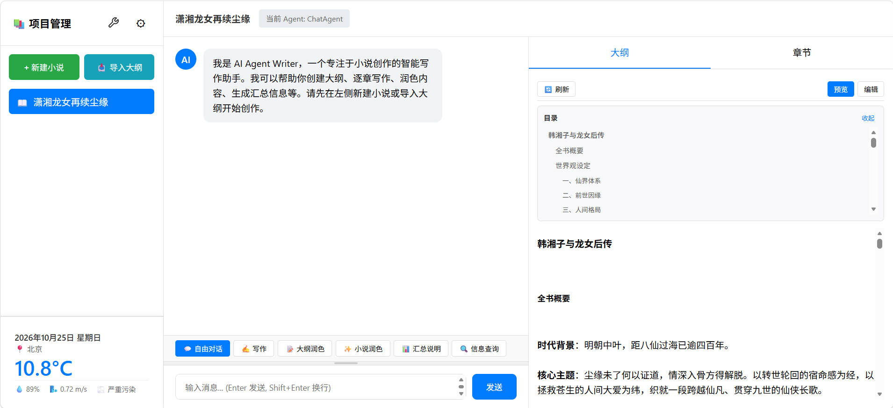

开发手册

有两个需要考虑的，一是怎么设计AI Agent？二是怎么在Agent的基础上开发Writer应用？

#### 怎么设计AI Agent：
（1）LLM模块：负责llm的正常接入使用（可设置参数）和异常处理（比如请求超时、超时重试，最大调用次数，上下文压缩，重复错误避免），对接不同接口形式不同厂商的llm（含降级处理）
（2）Agent-Loop模块：掌管agent的调用运行，包括接入llm，各种工具，各类钩子函数（节点检查，人为介入）等等
（3）Tools模块：负责提供并接入各种三方能力，包括内置工具，skill，mcp，sub-agent等
（4）Message模块：负责记录并处理Agent运行时各种“消息”，包括上下文对话历史、工具调用执行历史、Agent运行日志等等，实现会话持久（项目消息树）
（5）其他模块：包括沙箱运行模块、全局钩子函数模块、远程API模块、知识库模块（如memory，数据库rag）、提示词模块、配置模块

关键的harness设计：llm参数设置+异常处理、Agent-Loop询问、主+子智能体切换、小说项目会话持久、小说项目沙箱运行、知识库RAG

#### 怎么开发Writer应用
（1）Writer前端网站页面放在 src/web下，前端使用Vue架构。前端接口及AI Agent包装为后端服务，放在/src/app下，后端采用FastAPI。前后端采取C/S架构通信，方便后续在生产环境分离部署
（2）参考下图，Writer前端网站要实现下面几块功能：
    1.左边栏：用于显示小说项目列表，最上方显示一个动态组件（包括宠物动态icon、所在城市、天气）、组件下方显示【新建小说】/【删除小说】、再下方就显示各个小说项目名称、左下方角落显示通用设置和AI工具的button入口。小说文件要能导出到本地
    2.通用设置：包括页面主题颜色、小说字体大小、小说字体风格 / AI工具：包括大模型API设置、写作sub-Agent、写作Skill设置
    3.主页面（中间栏）：用来显示小说页面，最上方显示【阅读模式】和【编辑模式】。阅读模式下主页面展示小说目录和正文（类似阅读软件那样），目录可以展开收回；编辑模式下可以修改小说正文，增删小说卷章和修改卷章名称
    4.右边栏（点击右上角的Agent图标可以展开收回）：用于展示与AI沟通的会话内容（不同小说项目会话内容隔离，仅展示当前小说项目的会话）以及对话输入窗口，同时要能主动添加 写作sub-Agent、写作Skill和阅读过的小说章节，要能切换添加的模型

    