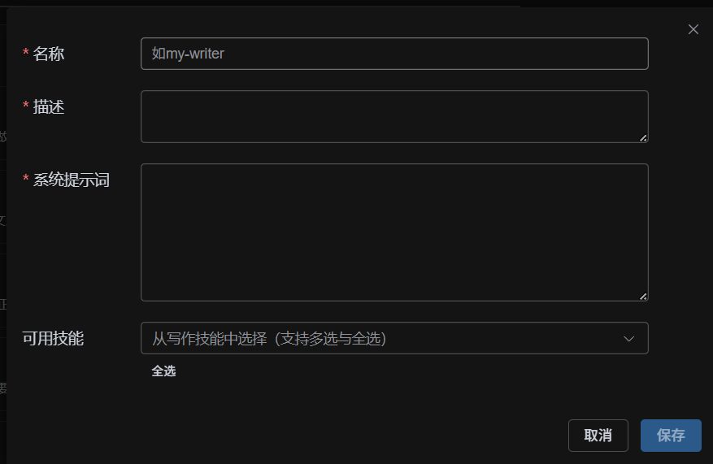

（1）Agent项目组织优化

	（1.1）把tools和skills合并在一起，原内置工具放在 tools/builtin下，用户自建skill放在tools/users。新增内置子代理Writer、Reviewr、Web_Searcher，放在subagents/builtin，用户自建子代理放在 subagents/user里
	（1.2）把写作过程中的一些固定流程（比如写小说要经过审批-生成-校验几个流程）都放在 agent/workflows下面。把一些写作之外的门禁，沙箱和钩子函数放在agent/harness目录下
	（1.3）整个agent目录下应该包含 llm、loop、workflows、harness、subagents、tools、trace等7个主要模块，trace用户处理消息和日志

（2）

（3）后端项目组织优化

（4）增加同步网盘功能

（5）llm成本优化，使用体验优化

（5）应用->客户端，删除langfuse代码
