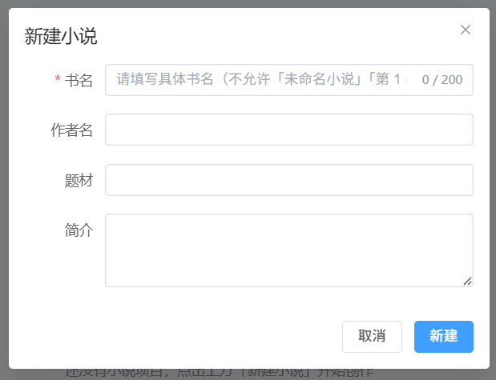
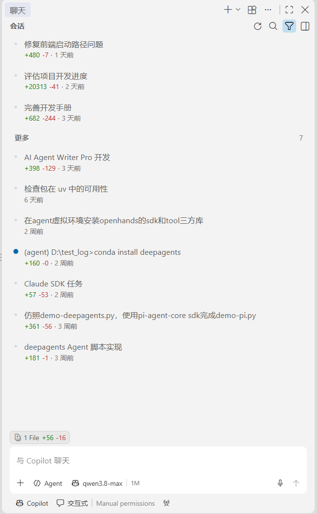
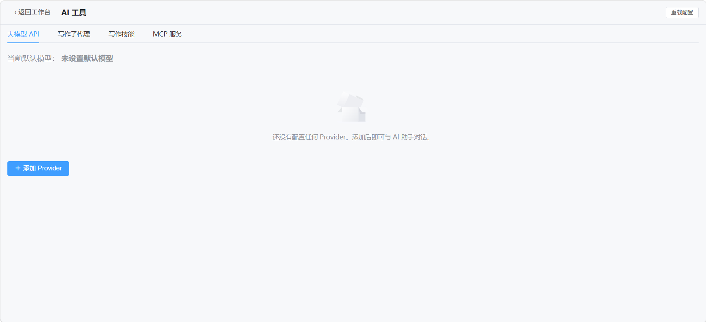
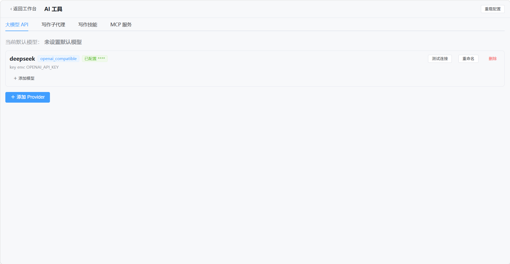
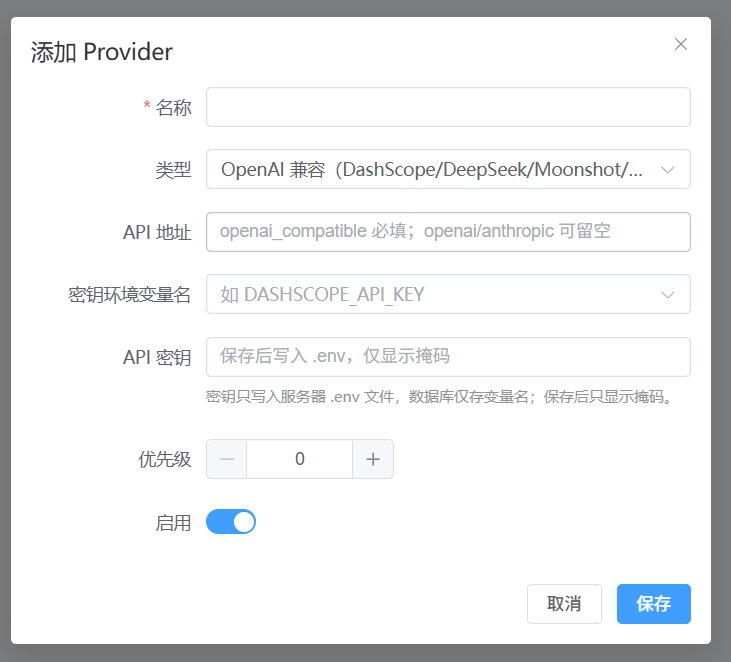
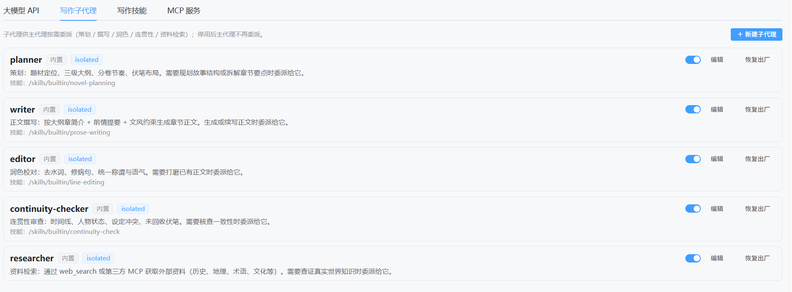
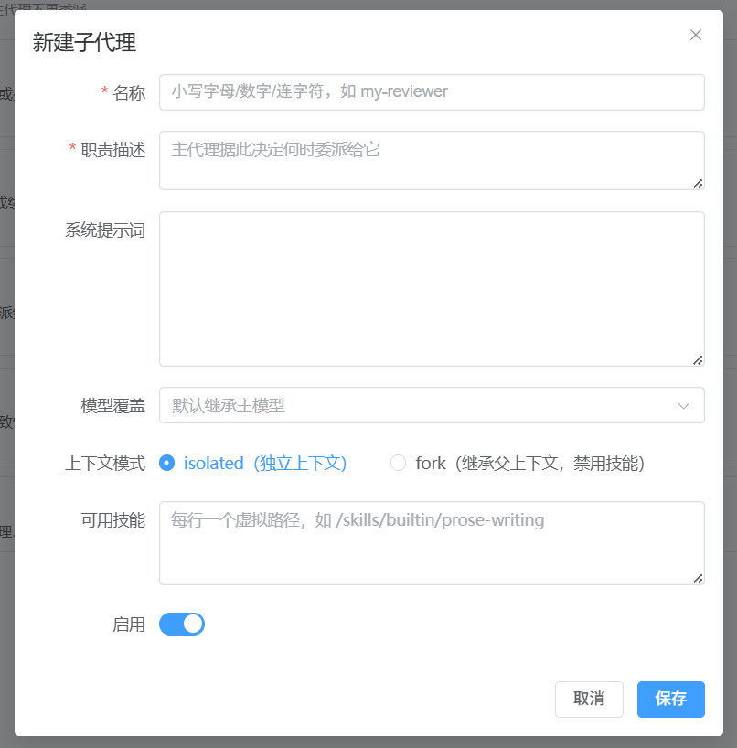

应用更新 v1028 ，主要集中在前端展示，下面是应用页面和对应页面上待修复的内容

---

（1）左上角的动态组件变更：
    ✔（1.1）宠物组件分为十二种对用十二生肖，对应的时间段刷新页面后就展示对应生肖动物，如果不刷新就不变
    ✔（1.2）天气组件不好看，并且我还要求增加展示天气质量。然后除城市需要获取定位外，天气、温度、空气质量都需要在刷新时根据MCP获取实时数据
（2）左边栏中间变更：
	✔（2.1）没有小说项目时就不展示提示 “还没有小说项目，点击上方「新建小说」开始创作”
	✔（2.2）有小说项目时，默认选中上次打开的项目
	✔（2.3）小说项目是一行一个，只出现小说名称和最右边的 ··· （···用于放重命名，删除和导出的入口），最好能在左边加上书籍相关的icon。
	✔（2.4）鼠标光标停留在小说项目时会出现悬浮框，从上往下依次是作者，题材和简介，没有作者和题材时就展示简介内容

---

（1）中间栏（主页面）变更：

	✔（1.1）目录不要放在最上面，如果没有小说项目的时候就不展示目录；有小说项目的时候目录展示在中间月阅读区域的左上角，要求点击可以展开收起目录
	✔（1.2）没有小说项目时，提示应该是”还没有小说项目，点击「新建小说」开始创作“

---

（1）新建小说弹窗页面变更：

	✔（1.1）[书名]输入框内的提示改为必填，[书名]左上角的*号去掉，必填这个校验逻辑不变
	✔（1.2）[书名]输入框内原提示用一个小的悬浮弹窗收起来放在[书名]左上角，提示内容应该是”书籍名称不允许为空，不允许全部为阿拉伯数字，不允许出现#$%等特殊字符，可以出现标点符号“，书名校验内容改成这个

	✔（1.3）[作者名]改为[作者]，[简介]也是必填，内容不限

---

（1）右上角AI助手变更：
	✔（1.1）AI助手改为  AI写作助手。其次这个标识太平淡，可以在 AI写作助手左边加一个 类似聊天框的icon。然后在展开AI会话框时，只出现聊天框的icon，点击它可以收起AI会话框
	✔（1.2）鼠标光标悬浮在 AI写作助手 上停留时，会出现提示”来试试AI写作功能吧，它可以实现创作小说、润色大纲、检验剧情、剧情汇总等等功能“
（2）右边栏AI会话框变更，总体上可参考vscode copilot的会话框：

	✔（2.1）删除最上面意义不明的 AI助手 和 + 号。用于展示当前会话数量 和 当前小说项目token使用量
	✔（2.2）中间那一大段提示都删除，在没有小说项目时，会话框中间提示” 还没有小说项目哦~“；如果有小说项目没有开始AI对话，会话框中间提示”快点来开启AI写作吧~“
	✔（2.3）会话框默认展示当前小说项目下的会话记录（会话记录名称是当前会话下第一个问答的问题总结 + 小字号的日期），最上面的会话最新，最下面的会话最旧，最多支持展示50条会话记录
	✔（2.4）点击任一会话记录可进入当前会话，形制类似主流的AI对话框，一问一答，但每个问答下面都要小字标记日期和时间

---

（1）AI联调输入框变更，总体上可参考vscode copilot的会话框：

	✔(1.1) 聊天输入框可参考上图copilot的形制，但内容要精简，输入框内只包含 +、工具、Model、上下文使用情况和发送箭头
	✔（1.2）+ 代表添加文件内容，可添加的对象包括小说项目里的大纲和章节，以及所在设备本地的其他文件（要大模型能理解的）
	（1.3）工具代表可引用 子代理、技能和MCP服务
	✔（1.4）Model表示选择使用的大模型，在AI设置（把AI工具改成AI设置）里可以配置，如果选中某个模型则显示模型名称，如果未选中模型或者没有配置的模型，则显示Model Off
	✔（1.5）上下文使用情况 展示为 {当前模型已使用上下文token}/{当前模型的上下文窗口值}，使用K为单位
	✔（1.6）发送箭头点击代表发送问题，需要特别处理的是，如果当前有大模型在思考，再次点击时需要发送箭头改成类似回车 <-的标记，点击有三种选项 ：停止并发送，通过消息引导发送，添加到队列 ，同样是参考copliot的设定

---

（1）通用设置页变更：
	✔（1.1）主题改成 深色、浅色和护眼模式三种选择，选择不同主题色时整个应用背景也会随之改变。不需要更多主题颜色
	✔（1.2）正文字号调整要在合理的范围（不要太小也不要太大），然后字体就给几种开源免费的字体就行，修改字号和字体，阅读和编辑模式下小说显示会随之改变。此外阅读页宽设置删除
	✔（1.3）自动保存间隔，最少10s，最多60s，目的是确保在编辑模式下辅助用户主动保存内容，避免丢失
	✔（1.4）动态组件设置不要，删除；AI工具设置不要，删除；最下方的运行状态乱七八糟的删除
	✔（1.5）页面左上角只要返回箭头就可以，不要”返回工作台“字样；然后保存移到所有设置的下面，旁边加一个恢复默认设置的选项

---

✔（1）AI设置页变更：（AI工具改成AI设置）
✔（2）大模型添加页-无模型变更：

	✔（2.1）删除右上角重新配置这一功能
	✔（2.2）[大模型API]改成[大模型]
	✔（2.3）删除"当前默认模型： **未设置默认模型**"，不需要展示这个
	✔（2.4）页面中间的提示”还没有配置任何 Provider。添加后即可与 AI 助手对话。“改成 ”还没有配置任何大模型。添加后即可与 AI 写作助手对话。"
	✔（2.5）[添加Provider]改成[添加大模型]，并且放在页面右上角

---

（1）大模型添加页-有模型变更：
	✔（1.1）部分修改在 上面已指出，不需要重复说明
	✔（1.2）每一条大模型配置栏展示情况为：左边为模型名称（需要加粗大一点字号），然后在名称右边小字灰色显示超时时长、Temperature和Max Token参数配置；右边显示测试连接、编辑和删除三个button，点击编辑可以进入当前模型的配置弹窗。其余多余东西不要

---

（1）大模型配置弹窗变更：

	✔（1.1）删除顶部“添加Provider”提示，下面的填写框整体往左移
	✔（1.2）[类型]改成[协议类型]，里面的选项不要，改成OpenAI Chat Completions、Anthropic Messages、Google Gemini这三种，默认选中OpenAI Chat Completions
	✔（1.3）[API地址]改成[Base Url]，输入框里面的提示不需要
	✔（1.4）[密钥环境变量名]改成手动输入的，不要选项，输入框可以提示如 QWEN_API_KEY
	✔（1.5）[API密钥]输入框提示改成 保存后写入环境变量，仅显示掩码。[API密钥]下方的提示不要
	✔（1.6）[优先级]不要，[启用]不要
	✔（1.7）在后面增加 超时时长、Temperature和Max Token这三个常见的模型设置选项，其中超时时长是左增右减框，默认是30s，最少10s，最多60s；Temperature是输入框，默认是1.0，不同协议类型对应的取值范围不一样，OpenAI Chat Completions对应是0~2，Anthropic Messages对应是0~1，Google Gemini对应是0~2，不包括0，需要做校验；Max Token默认是2048，可以手动修改，不做限制。上面这些配置都写入数据库（除API密钥外）
	✔（1.8）上述这些配置都是必填，不允许空着

---

（1）写作子代理页变更：

	✔（1.1）最上方的提示“子代理供主代理按需委派（策划 / 撰写 / 润色 / 连贯性 / 资料检索）；停用后主代理不再委派。”作为启用停用button悬浮窗口展示，这里不展示
	✔（1.2）子代理介绍删除技能，只展示职责
	✔（1.3）右边的启用停用button要在旁边加一个“启用”，编辑需要加一个外框，恢复出厂改成恢复默认（只有内置代理有这个功能）

---

（1）子代理添加弹窗变更：
	✔（1.1）删除顶部“新建子代理“
	✔（1.2）[名称]中输入框提示改成“如my-writer”
	✔（1.3）[职责描述]改成[描述]，删掉输入框提示
	✔（1.4）[系统提示词]也是必填项
	✔（1.5）删掉[模型覆盖]功能
	✔（1.6）可用技能采用多选的形式（支持全选），从写作技能中读取技能，多选勾选中后会显示选中的技能
	✔（1.7）删掉[启用]，这个功能在子代理创建后才使用

---

（1）写作技能页变更：

	✔（1.1）删掉顶部提示“技能以 SKILL.md 渐进披露给 Agent（模型按需 read_file）；启用即物化到 data/skills/。”
	✔（1.2）删掉[重新物化]，这个技能有啥用？
	✔（1.3）删掉这些内置的技能，内置的技能应该展示read，edit，list，grep，glob，web_serach这些工具（内置技能不用展示技能描述），新建子代理时也能选中这些工具
	✔（1.4）每个技能右边显示查看和编辑，内置技能（read，edit这些）这两个入口都置灰

---

（1）新建技能页变更：

	✔（1.1）删除顶部“新建技能“
	✔（1.2）[技能名]改成[名称]，删除输入框里面的提示以及下面的提示“改名会迁移物化目录；创建后不可再改。”
	✔（1.3）[描述]删掉输入框的提示

	✔（1.4）[技能正文]也是必填项，删除输入框提示
	✔（1.5）删除[allowed-tools]和[启用]，自建技能只包含提示词，不需要其他脚本资料

---

✔删除MCP服务这一栏，但保留内置的天气mcp供使用，最后美化一下整个AI设置页面，让大模型、子代理和技能三个入口隔开一点应用更新v1028.md
