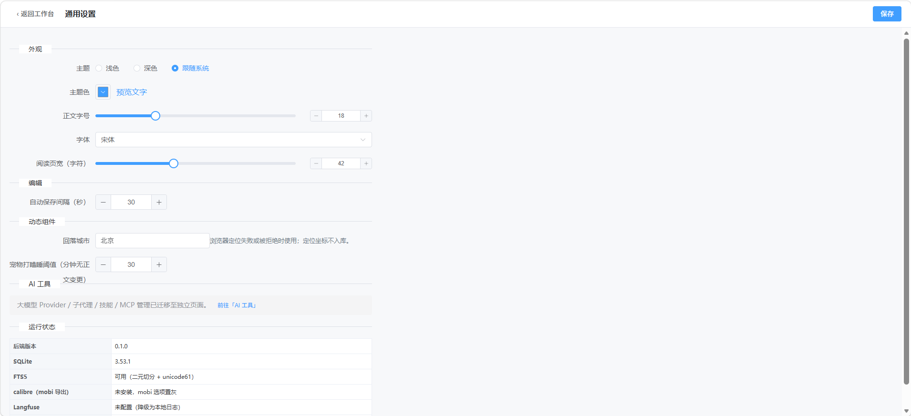
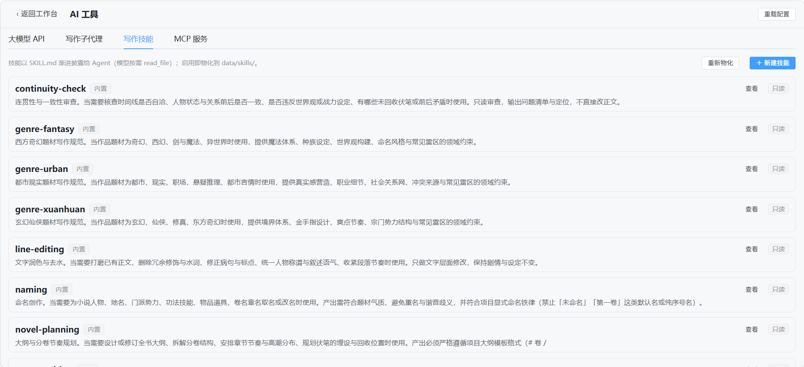
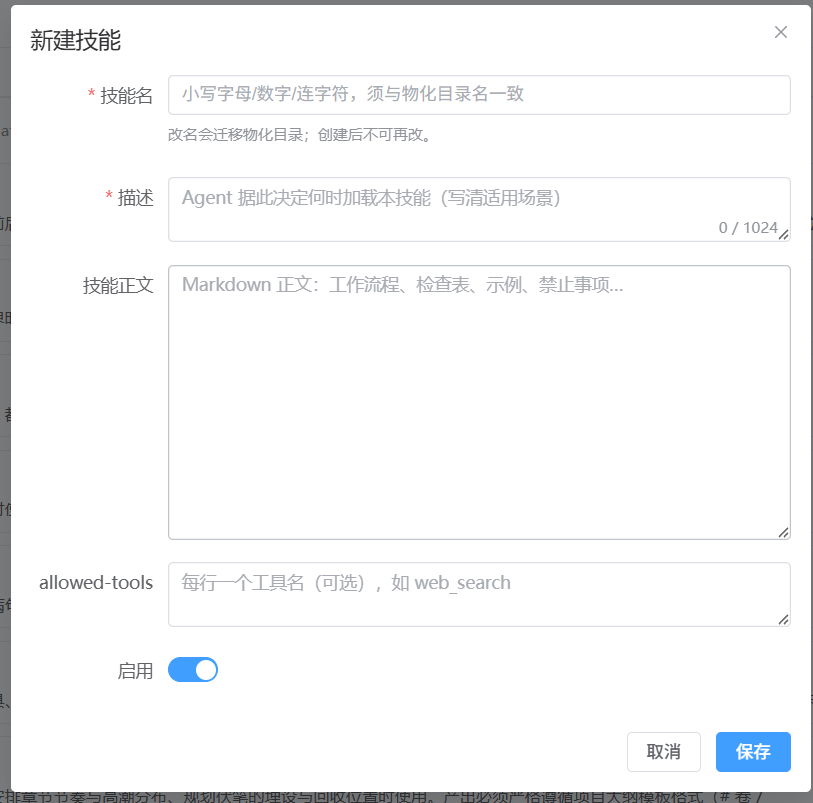
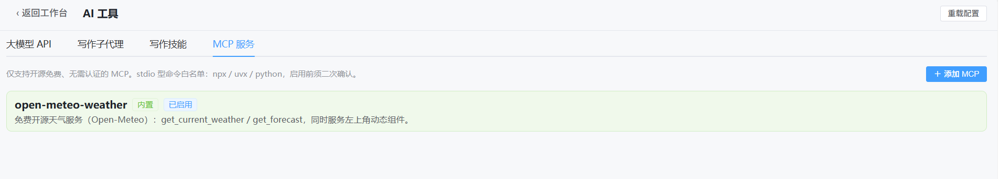

应用更新 v1028 版本，下面是待修复的内容和所在页面

---------
（1）左上角的动态组件变更：
    （1.1）宠物组件分为十二种对用十二生肖，对应的时间段刷新页面后就展示对应生肖动物，如果不刷新就不变
    （1.2）天气组件不好看，并且我还要求增加展示天气质量。然后除城市需要获取定位外，天气、温度、空气质量都需要在刷新时根据MCP获取实时数据
（2）左边栏中间，没有小说项目时就不展示提示 “还没有小说项目，点击上方「新建小说」开始创作”

---------
（1）

---------

---------

---------

---------

---------

---------

---------

---------

