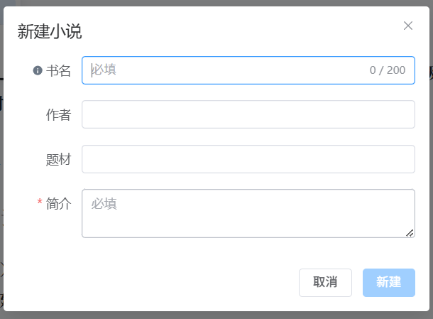
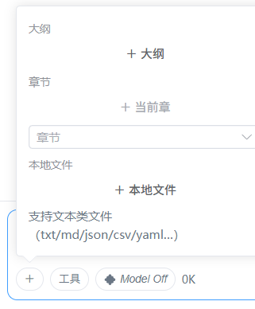
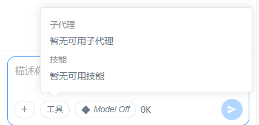
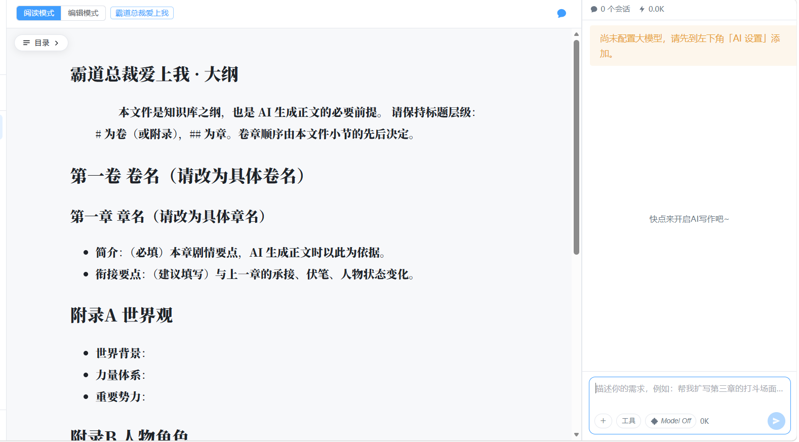
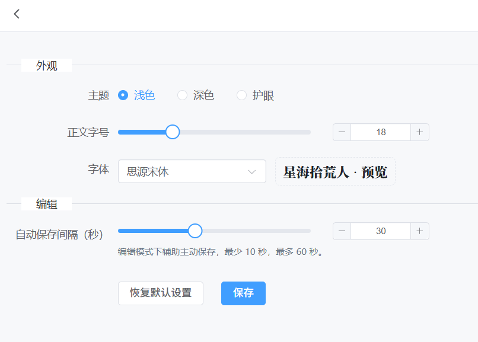
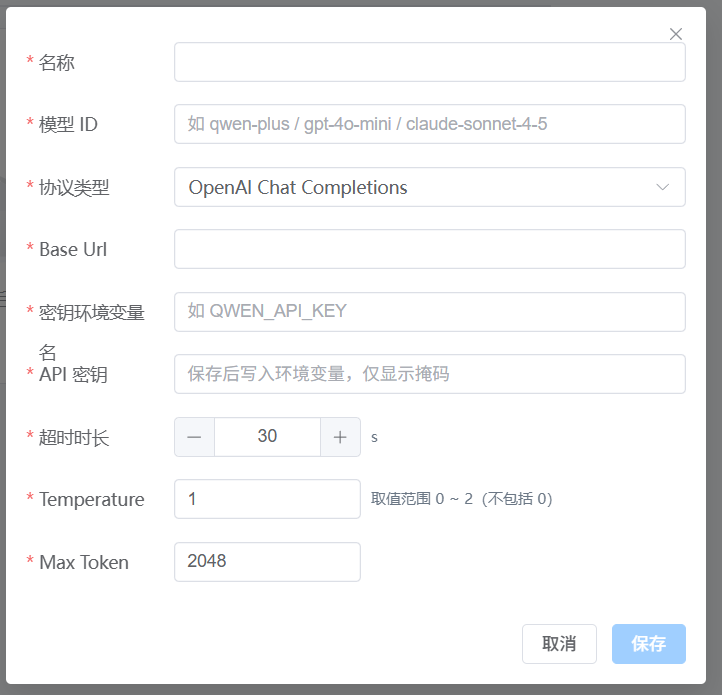
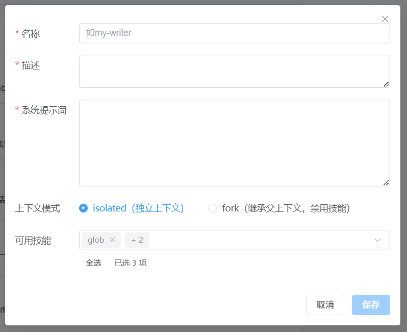

应用更新 v1028 ，主要集中在前端展示，下面是应用页面和对应页面上待修复的内容

---

（1）动态组件变更：
	✔（1.1）宠物组件不需要显示“狗”和“戌时”，把宠物头像上移，然后下方显示年月日和星期几
	✔（1.2）组件右边的天气，排布不好看，我希望最上方那一排显示 城市（大字号）+ 具体地址（小字号），地址过长时以...结尾，光标停留在此处时可显示完整地址；中间那一排左边显示天气icon（晴天）+天气说明小字（比如晴），右边显示空气质量+小字号的AQI值；最下面那一排用小字号分别显示温度、湿度和风速（级别为单位），体感温度删除

---

（1）新建小说页变更：
	✔（1.1）[书名]左上角需要显示*

	✔（1.2）[书名]和[简介]输入框不要任何内容
	✔（1.3）[题材]这个改成勾选框那种，可以选择诸如 玄幻/仙侠/武侠/都市/架空历史 ……等标签，最多勾选三个，最少一个

---

（1）小说项目显示变更：

	✔（1.1）小说名 右边显示小字的题材标签
	✔（1.2）鼠标光标停留在小说项目时展示简介内容，但简介展示在小说项目下面

---

（1）阅读模式显示变更：

	✔（1.1）新建小说 的大纲要改成  小说名称_大纲
	✔（1.2）目录展开后，最上方的 小说名称_大纲 左边要改一个合适的icon
	✔（1.3）大纲下方为卷（格式为第X卷 卷名），卷展开后二级目录为章节（格式为第X章 章节名），注意一级和二级目录都要在一个目录框下

---

（1）编辑模式显示变更：

	✔（1.1）页面右上角[已保存]，右边应为 “自动保存已开启（X秒）”
	✔（1.2）编辑模式下，主页面的“请保持层级：# 为卷（或附录），## 为章；简介行以「- 简介：」开头。”删除
	✔（1.3）被[目录]遮挡的button删除不需要，不要有任何button被[目录]遮挡
	✔（1.4）编辑模式下，主页面（显示小说或大纲的页面）右上方需要新增几个功能，包括 [往前插入小说卷]、[往后插入小说卷]、[往前插入小说章节]、[往后插入小说章节]（这几个都以icon形式的button显示，鼠标光标停留时显示对应功能），以及 [重命名] 和[删除] 功能。
	✔（1.5）[往前插入小说卷]、[往后插入小说卷]、[往前插入小说章节]、[往后插入小说章节]这几个入口点击后展示一个小弹窗，弹窗里包括必填的卷序号或章节序号，以及卷名或章节名。其中的检验逻辑为，卷序号或章序号为正整数且不能与已有卷章序号重复，卷名或章节名 的命名规则和书名的命名规则一样。弹窗内输入框不要提示词
	✔（1.6）点击[重命名]后显示重命名弹窗，弹窗内包含章节名和卷名，其中卷名默认填入当前章节所对应卷名（也就是默认不修改卷名）
	✔（1.7）点击[删除]出现二次确认弹窗，二次确认后才能删除，某一卷下所有章节都删除后卷也不存在
	✔（1.8）上面的卷章结构和增删改查逻辑要同步到后端

---

（1）AI会话框上方变更：
	✔（1.1）上方显示 X个会话 和 x.y K Token，会话数的icon换别的
	✔（1.2）提示“尚未配置大模型，请先到左下角「AI 设置」添加。”删除，未配置或者未选择大模型时不需要提示

---

（1）添加文件页变更：

	✔（1.1）这个页面太难看了，你会不会设计？首先最下面的“支持文本类文件……"提示删掉，但隐藏的逻辑是只能添加单个文件，文件格式为Markdown、TXT、JSON（应用内工具能直接读取），单个文件大小不超过5M，所有添加的文件不超过20M，当前问答结束后要释放文件缓存
	✔（1.2）添加文件页最上面是搜索框，用于检索定位应用内小说项目目录。再下方是[小说项目大纲或文章]、[本地文件]和最近打开的小说章节（最多展示10条）
	✔（1.3）点击[小说项目大纲或文章]，跳转到小说目录，点击某小说跳转到大纲和卷目录，点击卷跳转到章节目录，跳转过程中不需要返回
	✔（1.4）添加大纲，章节或者本地文件后，在聊天对话框最上面标记显示，发送消息后大模型需要同时处理这些东西

---

（1）AI工具添加弹窗变更：

	✔（1.1）这个页面也不好看，不需要”暂无可用子代理/技能“这种提示！
	✔（1.2）点击工具后展开的弹窗里显示[写作子代理]和{写作技能]，点击任一个可跳转到子代理或技能目录，没有时就什么不显示，跳转过程中不需要返回
	✔（1.3）选中子代理或技能后，在聊天对话框开头展示 #子代理名或@技能名，发送消息后大模型要主动使用这些工具

---

（1）大模型选择弹窗变更：

	✔（1.1）在 Model Off左边不需要展示icon，然后”Model Off“不要斜体
	✔（1.2）点击[Model Off]后，弹窗内不要显示Model Off这个选项！没有大模型时就在弹窗里提示”尚未配置大模型“
	✔（1.3）点击[Model Off]后若弹窗里有配置好的大模型，点击该大模型名称后收起弹窗，此时[Model Off]改成[{大模型名称}]
	✔（1.4）在[Model Off]右边显示 {1-当前模型上下文使用百分比}，上下文使用百分比} 计算方式为当前会话已占用的 token 数量 ÷ 模型上下文窗口总容量，每次大模型工作完并回复结果后 这个比值就刷新更新；若另开新会话就重新回到100%；若某个会话中上下文超过窗口值也就是这个比值变成0时就启动上下文压缩机制

---

（1）新功能增加
	✔（1.1）右边栏的AI会话框默认是这个宽度，可以向左拉伸到主页面的1/3，注意此时小说阅读页面和编辑页面也要自适应
	✔（1.2）AI聊天输入框随着内容不断输入，输入框可以自适应上拉，最多达到页面高度的1/3

---

（1）通用设置页变更：
	✔（1.1）功能设置排布不好看，不需要”外观“和”编辑“这两条分界线
	✔（1.2）功能设置名和功能设置离得太近了，隔开一些

---

（1）大模型添加弹窗变更：
	✔（1.1）不需要模型ID ，名称就等于模型ID
	✔（1.2）密钥环境变量没有名称要求限制！可以任意命名；保存后密钥环境变量要保存在系统级环境变量（适配windows，linux和macos）
	✔（1.3）超时时长改为 Time Out
	✔（1.4）这几个设置名字号要小一些，一行展示；输入框也不需要这么长，都把右上角的X挡住了，同样要调整的还有子代理添加弹窗、技能添加弹窗
（2）大模型显示页变更：

	✔（2.1）配置好的大模型展示应为：上方显示模型名称，下方用小字号显示Time Out=X  Temperature=X  Max Token=X

---

（1）子代理添加弹窗变更：

	✔（1.1）删除[上下文模式]，默认采用独立上下文，但和主Agent一起算Token消耗
	✔（1.2）[可用技能]选中多个技能时，需要在输入框展示出来，但最多显示6个
✔（2）配置好的子代理显示要求下面的描述不要太长，过长就用省略号截断，反正是不要超过[启用]
