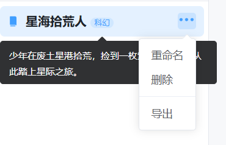
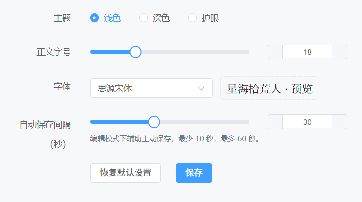
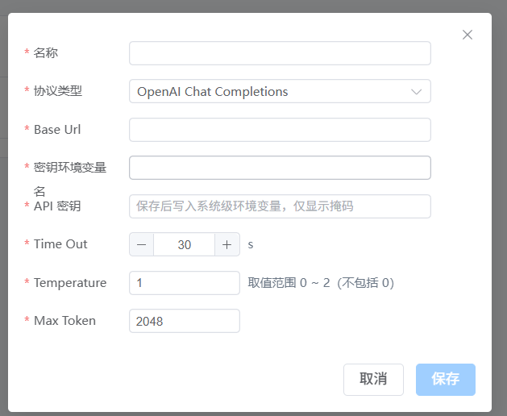
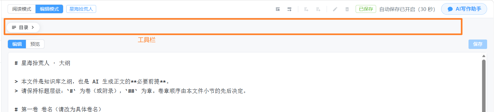
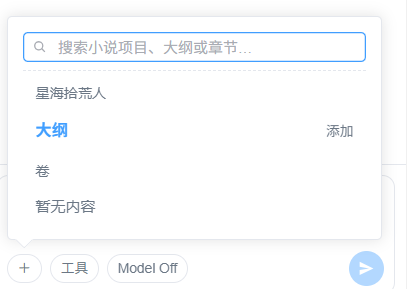
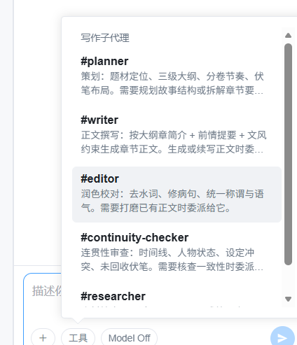

应用更新 v1030 ，主要集中在前端展示，下面是应用页面和对应页面上待修复的内容

---

（1）动态组件变更：
	✔（1.1）右边的天气组件中，城市和地址挤在一起不好看，修改方案是 城市在最上排居中，然后鼠标光标移动到城市上会悬浮显示完整的地址
	✔（1.2）天气组件中间这一排空气质量这一块，把 污染程度和AQI值的展示特效换一下，污染程度突出显示，AQI用小字显示在右下方，就像左边的天气晴一样
	✔（1.3）天气组件最下面这一排缺少单位，展示内容应该为 温度{X°}  湿度{Y%}  风速{Z级}，注意不要太拥挤

---

（1）小说项目管理变更：

	✔（1.1）[重命名]改成[编辑]，可以修改小说名称，题材和简介，类似新建小说那样

---

（1）通用设置变更：

	✔（1.1）新增[自动保存]开关功能，并且与[自动保存间隔]联动
	✔（1.2）删除[自动保存间隔]下面的 (秒)，然后[自动保存间隔]的提示改成 “编辑模式下辅助主动保存，时长单位为秒"

---

（1）模型配置展示变更：

	✔（1.1）感觉模型名称下面展示“Time Out=30 Temperature=1 Max Token=2048”不太好看，这三个挤在一起太丑了，给它们隔开一点，然后和上面的模型名称间距大一点，也就是整个条目变高一点
（2）大模型配置弹窗变更：

	✔（2.1）这个弹窗太小了，整个弹窗包括里面的字体输入框等 都等比例变大一些，后面的子代理和技能新建弹窗也一样
	✔（2.2）[密钥环境变量名]改成[密钥名]，[API密钥]改成[密钥API]

---

（1）编辑模式展示变更：
	✔（1.1）上图我将“目录”入口所在那一行标记为工具栏，然后把页面最上方的插入卷、插入章节、重命名和删除按钮都移到工具栏这一行，位于“目录”右边
	✔（1.2）把[保存]功能移到工具栏（保存用icon表示），然后在[保存]右边用 增加"自动保存"的标记（就用文字+外框标识），如果开启了自动保存就显示绿色，没有开启就显示灰色。同时删除页面最上方右边“**已保存**自动保存已开启（30 秒）”这个标记

	✔（1.3）删除正文上面的预览和编辑，编辑模式下只有编辑状态

---

（1）文件添加变更：

	✔（1.1）点击 + 后最上方展示的那个搜索框是用来直接搜索小说大纲或者小说章节的，搜索规则是关键字匹配，搜索出来后就动态展示在列表上，同时小字标记所属的 小说项目 或小说项目/卷。搜索框右边支持清空icon，手动删除或者清空内容后回到原来的状态，不要一直停在搜索结果列表
	✔（1.2）点击 + 后，点击[小说项目大纲或章节]（文章改成章节）进入小说项目二级目录，此时顶部不要出现“选择小说项目”的提示，如果没有小说项目就居中提示“还没有小说项目”。

	✔（1.3）接（1.2），如果有小说项目，右边不要显示“X章”！点击小说项目进入三级目录，最上面是 小说名_大纲，下面是各个卷，如果没有卷就不显示，不要显示多余的内容！点击大纲就代表添加该文件，此时收起弹窗，输入框上面标记添加的大纲

	✔(1.4) 接（1.3），如果有卷（有卷代表至少有一章节内容，这个逻辑可以同步到小说项目管理），点击卷进入四级目录，也就是章节的目录，点击某一个章节代表添加，就和大纲一样

	✔（1.5）关于 添加文件的窗口后，再打开就回答初始的界面，不然我没法返回重新添加其他文件

（2）工具添加变更：

	✔（2.1）缺少了[写作技能]的选项，添加某一技能后在输入框上面用@工具 标记
	✔（2.2）点击[写作子代理]或[写作技能]后进入二级目录，但关闭这个工具添加窗口后，再打开就回到初始的界面，不然我没法返回添加其它工具
