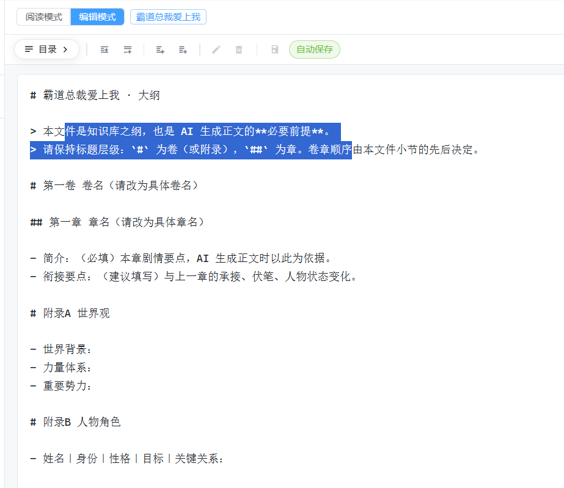
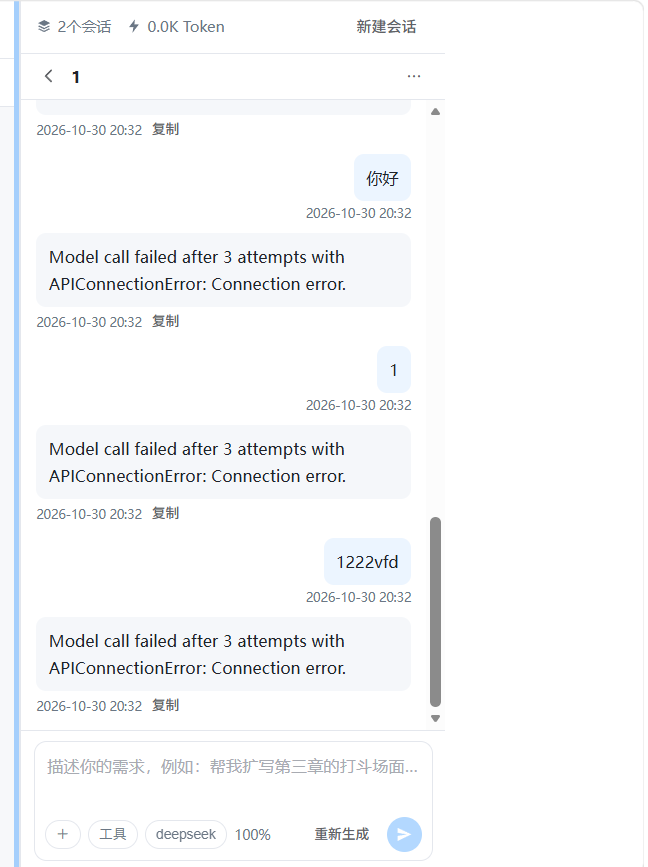
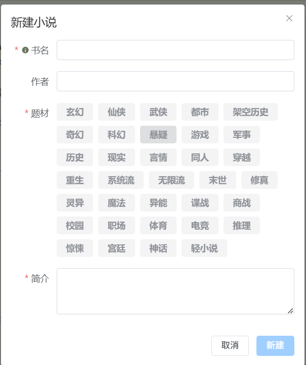

接续1030的版本更新，主要是在小说卷章管理逻辑和IA会话上

---

之前的卷章插入逻辑有问题，现在更新如下：
✔（1）内容展示：要想跳转展示内容，必须在大纲或者某一具体章节下，仅仅点击目录上的卷是不会跳转内容的，此时还是显示原来的大纲或章节内容
✔（2）大纲插入：大纲是在最前头，因此只支持往后插入卷，不支持插入章节，也不支持往前插入
✔（3）章节插入：定位到某一章时，支持往前往后插入卷和章节，插入卷时只需要填卷序号和第一章节的章节名（避免产生空卷，空卷是不支持的），插入章节时只需要填写章节名即可，卷序号和章节序号是自动增减的，可参考（4）和（5）
✔（4）卷序号增减逻辑：卷序号是自动增减的，比如只有大纲的情况下，点击往后插入卷，只需要填卷名就可以，创建的卷自动显示 {第一卷 卷名}。如果现在有三卷，在第二卷前面插入一卷，则第二卷及第三卷的卷数自动+1。如果在第二卷后面插入一卷，则该卷为第三卷，后面的第三卷变成第四卷。此外第一卷和最后一卷也可以往前往后插入。反之如果删除某一卷，则该卷后面卷的卷数自动-1
✔（5）章节序号增减逻辑：卷内的章节序号也是一样的，也是自动增减的，参考卷的插入逻辑即可
✔（6）AI润色：如果在编辑模式下选中一段文本（如上图蓝色部分），在选中文本区域就悬浮出现AI润色的button，点击这个按钮后这段文本会被添加到模型对话中（类似于添加文件并标记位置），后续用户可以针对这段文本让大模型帮忙润色修改，大模型要能够知道这段文本在文章中的所在范围然后修改

---

会话框现在是逻辑八糟的，整体更新要求如下（修改逻辑可参考vscode copilot）：
✔(1) 会话中展示：用户发送聊天框消息后，删掉最上方显示的 ”AI 正在思考… 停止“、右上角的[新建会话]和[···]，正确的逻辑是跳转到当前新建的会话内（如果在某一条会话内就不用跳转），AI正在思考/停止/复制 这些东西都放到会话内，你没有见过千问，deepseek这些常见大模型或Agent的展示逻辑吗？模仿主流AI Agent处理会话的逻辑
✔(2)会话中发送消息：已经发送消息并且Agent还未完成工作回复最终结果的时候，此时发送消息分为停止后发送、添加到队列、添加为引导三种模式，停止后发送是立刻停止当前Agent的工作并处理新消息，添加到队列就是等当前工作处理完再处理新消息，添加为引导就是在Agent处理过程中，在下一个步骤执行前插入这段新消息。这个也是模仿主流大模型和AI Agent处理会话的逻辑
✔(3)参考上图，在AI会话框上面不要显示“会话记录    2/50”这个，会话数量在最上面已经告诉我了
✔(4)Agent运行报错：大模型或者Agent在运行中出错时（比如大模型连接不通或者API失效等等），要给出中文提示并且告知用户应该怎么做，同时文字应该是灰色（代表异常不可用）

---

✔（1）会话框拉伸的同时，应该也是铺满右边屏幕的，要自适应尺寸不要留空白！
✔（2）拉伸的标记要在不同主题色下变化，浅色主题和护眼模式就显示黑色，深色主题就显示白色

---

✔（1）题材数量我想了想，最多显示28个吧，一定要是最主流的类型，可以参考番茄起点晋江这些网络消息
✔（2）在默认的28个题材后面显示一个"+"，点击后出现一个小的输入弹窗用于填写自定义题材名，保存后就新增一个题材，并且后面仍然显示一个"+"。但允许自定义题材的同时也需要遵循题材数量不少于一个，不多于三个的规则
✔（3）上面的修改在新建小说和编辑小说项目的弹窗均要完成