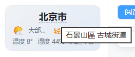
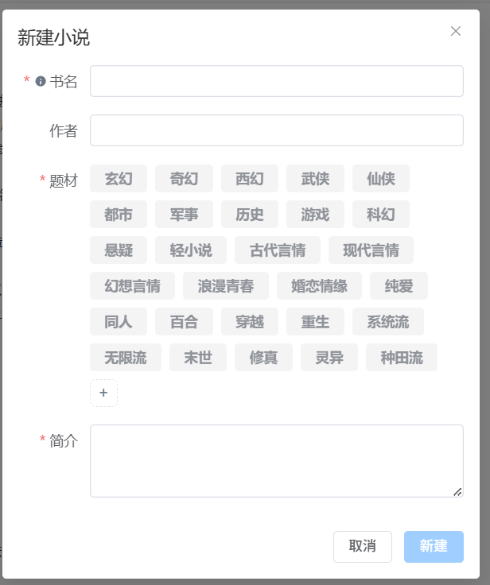
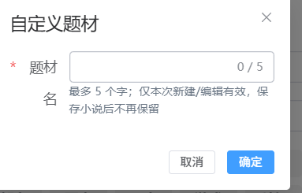
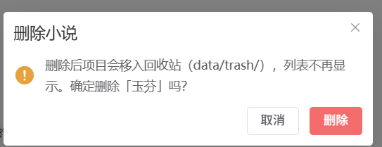
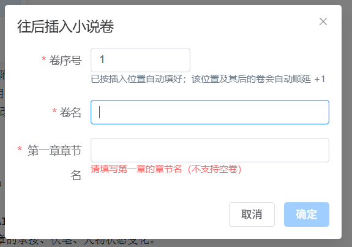
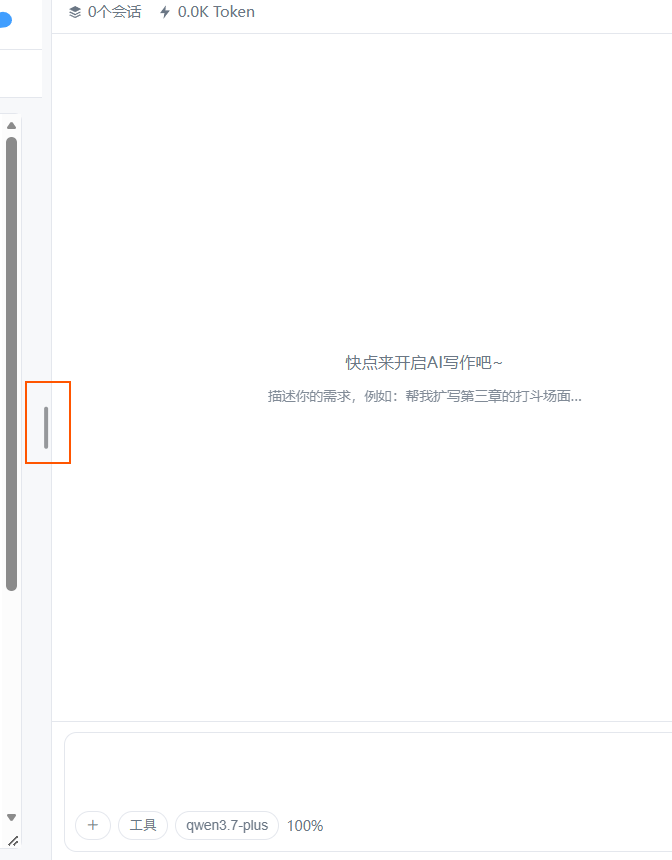
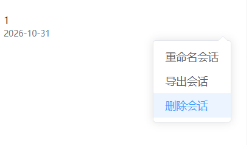
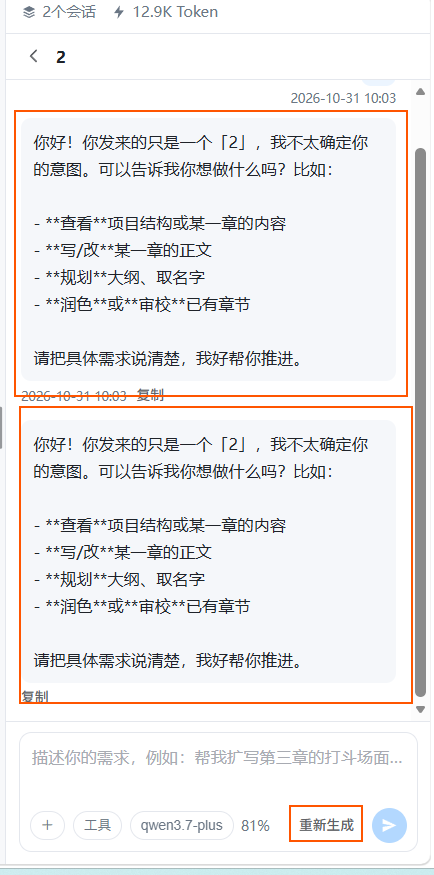

应用更新 v1030 ，下面是应用页面和对应页面上待修复的内容

---

✔（1）天气组件上这个“大部……"字号再小一点，和右边的“108”一样大
✔（2）这个AQI值 “108”和左边的“大部……"处在同一行的位置行，现在位置高了

---

✔（1）删除光标停留在城市出现具体地址的逻辑，没啥用，删了

---

✔（1）新建小说弹窗删除作者这一项

---

✔（1）自定义题材弹窗，把题材名改成题材，并且下面的提示语不要

---

✔（1）删除小说项目提示改成如：删除后《玉芬》会移入回收站，但不建议这么做！确定删除吗？
✔（2）新增[回收站]的功能，入口放在 AI写作助手的左边，回收站用于回收某本小说的某些章节，最多回收20本（只保存最近删除的20本）。点击回收站后展示近20本被删除过章节的小说（也包括整本小说被删除），点击某本小说进入到它的目录，展示 卷/该卷下被删除章节，点击某章节会出现回收删除的询问弹窗（左边是回收button右边是删除button，删除button用红色字体警示）。如果某本小说完全被删除了，那么回收某章节的同时还会恢复它在左边栏下的小说项目和它的大纲

---

✔（1）弹窗上方提示”往后插入小说卷“删除，类似的往前插入卷，插入章节都不要这种提示
✔（1）卷序号 下面的提示“已按插入位置自动填好；该位置及其后的卷会自动顺延 +1”删除，类似的往前插入卷，插入章节都不要这种提示
✔（2）第一章章节名 改成 章节名

---

✔（1）为什么我新建了卷找不到该卷下的章节呢，你的逻辑有问题，新建卷的同时也会初始化创建该卷下的第一章

---

✔（1）拖动AI对话框的拖动标记（红框那个位置的标记）颜色还是不对，我说了浅色主题和护眼模式下为黑色，深色主题为白色

---

✔（1）这个停止的功能是放在底部 AI聊条对话框 的消息发送按键上，就像主流的大模型和Agent那样处理，这个按键包含了发送消息，停止和追加消息三种形态，大模型正在思考但聊天框没有输入追加消息时就显示停止形态
✔（2）上面我发送的消息”1“下面怎么没有日期时间记录？

---

✔（1）把 导出会话功能 删掉

---

✔（1）为什么大模型回复会出现两条一样的消息？把下面的删掉！
✔（2）AI聊天框的[重新生成]功能删掉

---

✔（1）编辑模式下，在[保存]功能左边新加一个[回退编辑]的功能，用icon表示，用于回退当前章节的编辑，最多回退5次，类似word编辑那样

---

✔（1）回滚AI润色功能，即如果在编辑模式下选中一段文本（如上图蓝色部分），在选中文本区域就悬浮出现AI润色的button，点击这个按钮后这段文本会被添加到模型对话中（类似于添加文件并标记位置），后续用户可以针对这段文本让大模型帮忙润色修改，大模型要能够知道这段文本在文章中的所在范围然后修改
✔（2）AI会话过程中，如果出现报错信息，用简短的中文提示，不要用英文
✔（3）AI会话框中默认的大模型是上次使用的模型，不是新建的模型
✔（4）我已经配置好了大模型api，待修改完成后你可以采用自动化测试的方式测整个链路，包括小说项目的创建，卷章的插入编辑等逻辑，以及使用大模型润色或生成小说章节的功能，发现有问题的话修改
✔（5）最后，readme更新（功能介绍大幅度简化，加上开源协议）+Project-Develop更新
